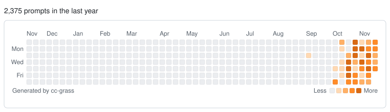

### 사용자도, 팀도 막히지 않게 만드는 프론트엔드 개발자입니다.

 

## 💡 이렇게 일합니다

> **🧪 실패 상황부터 설계하고, 내놓기 전에 확인합니다.** 
> Nova에서는 응답 유실·중복 신청·순번 조회 실패에 화면이 어떻게 대응할지 먼저 정하고, 고객 화면 Playwright E2E 테스트 60개를 직접 작성했습니다. Ephyra에서는 실제 백엔드에 연결해 QA를 진행하고 회귀 테스트 파일 3개를 남겼습니다.

> **📈 측정한 뒤 고칩니다.** 
> NEXT GACHA 홈의 모바일 LCP를 3.28s에서 1.78s로 줄였습니다(2026.10 운영 환경, Lighthouse 3회 중앙값). 11월 재디자인 뒤 생긴 CLS 회귀는 원인을 찾아 수정했습니다.

> **🤝 막힌 협업은 Mock을 먼저 만들어 풉니다.** 
> 디엔소프트에서 백엔드 API가 막바지에 나올 예정이라, Swagger 명세로 MSW Mock API를 먼저 만들어 개발과 테스트를 진행했습니다. Nova에서는 MSW 목 서버로 장애 상황을 재현했습니다.

 

## 🚀 대표 프로젝트

<table>
  <tr>
    <td width="33%" valign="top">
      <h3><a href="https://github.com/Nova-Grandis/fe">Nova</a></h3>
      
      
      
      
<b>휴대폰 사전예약 시스템</b>

      
7명 팀에서 Frontend 2명 중 구매자 화면 전담

      LG유플러스 유레카 최종융합프로젝트 · 2026.09–10
    </td>
    <td width="33%" valign="top">
      <h3><a href="https://github.com/UrecaCompProject/compProject">Ephyra</a></h3>
      
      
      
      
<b>AI 통신 요금제 상담·가입 서비스</b>

      
조장·PL로 상담 리포트·공통 UI·QA 담당

      유레카 종합프로젝트 · 2026.08–09 · Frontend 4인
    </td>
    <td width="33%" valign="top">
      <h3><a href="https://github.com/llmeajinll/Nextgacha">NEXT GACHA</a></h3>
      
      
      
      
<b>같은 상품을 1인당 5개까지만 살 수 있는 가챠 쇼핑몰</b>

      
기획·디자인·Frontend·Backend 1인 개발

      API Route 56개 · 관리자 백오피스 포함
    </td>
  </tr>
</table>

 

## 🧑‍💻 경력 · 교육

| 기간 | 내용 |
| :-- | :-- |
| 2026.04&nbsp;~&nbsp;10 | **LG유플러스 유레카** 프론트엔드 개발자 과정 |
| 2023.09&nbsp;~&nbsp;2024.03 | **디엔소프트** 현장실습 2023.09–12 → 계약직 전환 2024.01–03 Vue.js로 실서비스 4건 개발(교사용 LMS 리뉴얼, 사내 관리자 페이지, 전시회 이벤트 2종). 관리자 시스템은 개발 시점 기준 100개 이상 초등학교에서 사용했고, 전시회 이벤트는 3일간 754명이 참여했으며 현장 장애 대응을 맡았습니다. |
| 2019.03&nbsp;~&nbsp;2024.02 | **한국공학대학교** 컴퓨터공학부 소프트웨어공학과 |
| 2024.12 | **정보처리기사** |

 

## 🛠 Tech Stack

| 분류 | 기술 |
| :-- | :-- |
| **화면** |     |
| **데이터 · 상태** |  |
| **테스트 · 목 서버** |     |

 

## 🌱 AI와 함께 개발한 기록

<picture>
  <source media="(prefers-color-scheme: dark)" srcset="./ai-grass/dark.svg"/>
  
</picture>

Claude Code·Codex에 직접 보낸 요청 수(하위 에이전트 제외, 어제까지)입니다. 이 컴퓨터의 기록으로 매일 자동 갱신되며(<a href="https://github.com/chuqk/cc-grass">cc-grass</a>), 집계한 숫자만 올라가고 대화 내용은 올라가지 않습니다.

  

